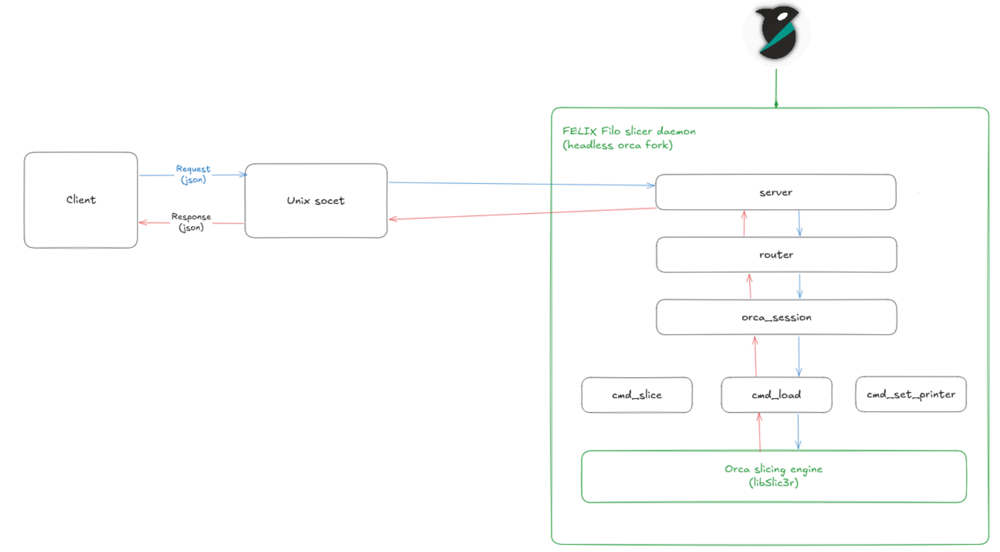
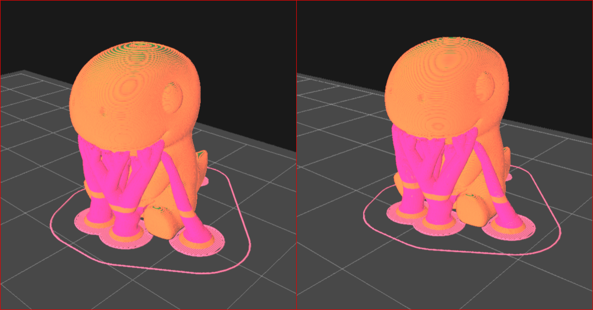

# FELIX Filo slicing daemon

> In computing, a daemon (/ˈdiːmən/ DEE-mən or /ˈdeɪmən/ DAY-mən) is a program that runs as a background process, rather than being under the direct control of an interactive user. _(Wikipedia)_

A daemon application that allows other applications to utilise Orca's slicing capabilities without linking directly against Orca Slicer.

## High-level overview

<p align="center">
  
</p>

The project uses a client–server architecture: the daemon acts as the server, and the client is any application that wants to use Orca's slicing capabilities.

Communication happens through a local socket, which supports bidirectional (two-way) communication between two separate processes (programs) on the same computer. The server side (the daemon) is responsible for creating this socket. Once the socket is created, the server listens on it for incoming connections and requests.

Messages are exchanged as JSON with standardized fields.

## Results

<p align="center">
  
</p>

Comparison between slicing using the daemon (left) vs Orca 2.5 GUI (right).

**Config**

- FELIX Pro3 with 0.35 mm nozzle
- normal quality

As can be seen there is no difference in results.

# API Reference

Api reference can be found in the [wiki](https://github.com/FELIXroboticsBV/FELIX-Filo-Slicer-daemon/wiki/API-Reference) of the repository

# Building

Only the daemon is built, not the full OrcaSlicer application. This takes two steps: build Orca's dependencies once, then build the `orca-daemon` target with the CMake preset.

### Requirements

- CMake 3.25 or newer (presets version 8 needs CMake 3.28+)
- Ninja
- A C++17 compiler: GCC/Clang on Linux, Xcode command line tools on macOS, Visual Studio 2022 on Windows

### 1. Build the dependencies

Dependencies only need to be built once, or again when `deps/` changes. They are placed in `deps/build`, which is where the preset expects them.

**Linux**

```bash
./build_linux.sh -u   # install system packages (needs sudo, first time only)
./build_linux.sh -d   # build dependencies only
```

**macOS**

```bash
./build_release_macos.sh -d -a arm64   # use -a x86_64 on Intel Macs
```

**Windows** (from _x64 Native Tools Command Prompt for VS 2022_)

```bat
build_release_vs2022.bat deps
```

> On Windows, the dependencies must be built in the same configuration as the daemon (Debug or Release), because MSVC cannot mix the two.

### 2. Build the daemon

From the repository root:

```bash
# release build with debug information for fast performance but slower debugging
cmake --preset orca-daemon-relwithdebinfo
cmake --build --preset orca-daemon-relwithdebinfo
```

> On Windows, run these commands from the _x64 Native Tools Command Prompt_ so Ninja finds the MSVC compiler.

This configures with `SLIC3R_GUI=OFF`, `SLIC3R_CAD=OFF` and `ORCA_DAEMON=ON`, and builds only the `orca-daemon` target into `out/build/orca-daemon-relwithdebinfo/`.

3. Run the daemon

Executable should be run from the root

```sh
./out/build/orca-daemon-relwithdebinfo/src/daemon/orca-daemon
```

## Using test client

Test client simple python program which is intended as a simple way to manually test the daemon. The python file can be found in the `src/daemon/client` folder.

### Configuring client

> do this while the daemon is running as you will need to read one line from the terminal

To configure the client open the `client.py` and change the `DEFAULT_SOCKET` path to the path displayed by the daemon.

```sh
# example daemon output
Staring up daemon`s server
Server initialized
         listening on socket: /run/user/1000/felix-daemon # this is what oyu need
```

So the python variable will become

```python
DEFAULT_SOCKET = "/run/user/1000/felix-daemon"
```

### Running the client

Navigate to the directory of the script

```sh
cd src/daemon/client
```

and run the program

```
python client.py
```

This will allow you to type commands one by one to the console and preview responses from the server.

Type `help` to see all possible commands.

### Example

```sh
> info ## you have typed this
>> {"id":4,"cmd":"get_state","params":{}} ###this is what is being send to the daemon
<< { ### this is what daemon replied
  "code": 200,
  "data": {
    "filaments": [
      "FELIX PETG Hardened Steel @ 0.35mm",
      ""
    ],
    "models": [],
    "num_extruders": 2,
    "printer": "FELIX Pro 3 0.35mm nozzle",
    "printer_key": "felix_pro_3",
    "process": "FELIX Plastic Normal @ 0.35mm"
  },
  "id": 4
}
```
